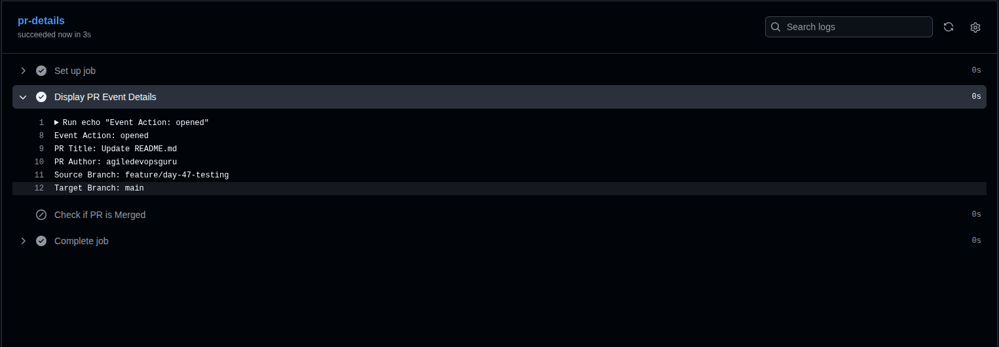

# Day 47 – Advanced Triggers: PR Events, Cron Schedules & Event-Driven Pipelines

## Challenge Tasks

### Task 1: Pull Request Event Types

Created `.github/workflows/pr-lifecycle.yml` to listen for these pull request activity types:

- `opened` – when a pull request is created.
- `synchronize` – when new commits are pushed to the pull request branch.
- `reopened` – when a closed pull request is reopened.
- `closed` – when a pull request is closed or merged.

The workflow prints the event action, PR title, author, source branch, and target branch. A separate conditional step runs only when the pull request is merged (`closed` and `merged == true`).

**Verification:** Create a PR, push another commit to it, reopen it after closing if needed, and merge it. Check the Actions tab for the different event actions.

**Screenshots to add:**

- 
- ``
- ``
- ``

Workflow: [PR Lifecycle](.github/workflows/pr-lifecycle.yml)

---

### Task 2: PR Validation Workflow

Created `.github/workflows/pr-checks.yml`, a basic pull-request gate that runs when a PR targets `main`.

It contains three independent jobs:

1. **`file-size-check`** – checks out the PR and fails if any changed, existing file is larger than 1 MiB (1,048,576 bytes).
2. **`branch-name-check`** – reads `github.head_ref` and accepts branch names beginning with `feature/`, `fix/`, or `docs/`.
3. **`pr-body-check`** – checks the PR description and prints a warning when it is empty. This job does not fail for an empty description.

**Verification:** Open a PR from a branch that does not use one of the allowed prefixes. The `branch-name-check` job should fail.

Screenshot to add: ``

Workflow: [PR Checks](.github/workflows/pr-checks.yml)

---

### Task 3: Scheduled Workflows (Cron Deep Dive)

Created `.github/workflows/scheduled-tasks.yml` with two schedules and a manual trigger:

- `30 2 * * 1` – every Monday at 2:30 AM UTC.
- `0 */6 * * *` – every six hours.
- `workflow_dispatch` – allows the workflow to be started manually from the GitHub Actions tab.

The workflow prints the cron expression that triggered it using `github.event.schedule`. It also performs a simple HTTP health check and fails if the URL does not return a successful HTTP status.

**Cron expressions:**

- Every weekday at 9:00 AM IST: `30 3 * * 1-5` (IST is UTC+5:30, so 9:00 AM IST is 3:30 AM UTC).
- First day of every month at midnight UTC: `0 0 1 * *`.

**Why can scheduled workflows be delayed or skipped?**

- Scheduled workflows run on GitHub-hosted infrastructure, so busy periods can cause delays.
- GitHub may drop scheduled jobs during periods of high load; schedules near the start of an hour are especially susceptible.
- Scheduled workflows run only on the repository's default branch.
- In public repositories, scheduled workflows can be automatically disabled after 60 days of repository inactivity. A schedule can also be affected if the repository is disabled or archived.

Screenshot to add: ``

Workflow: [Scheduled Tasks](.github/workflows/scheduled-tasks.yml)

---

### Task 4: Path & Branch Filters

Created two workflows to understand path and branch filtering.

- `.github/workflows/smart-triggers.yml` runs on pushes to `main` or `release/*`, but only when a file under `src/` or `app/` changes.
- `.github/workflows/ignore-docs.yml` runs on pushes to `main` or `release/*`, except when all changed files match the ignored Markdown or `docs/` paths.

**Verification:** Push a Markdown-only change. The `ignore-docs.yml` workflow should be skipped. A Markdown-only change should also not trigger `smart-triggers.yml`, because it does not match the included paths.

**When would I use `paths` vs `paths-ignore`?**

- Use `paths` when a workflow should run only if specified files or folders change.
- Use `paths-ignore` when a workflow should run for most changes but skip changes limited to specified files or folders.
- Do not define `paths` and `paths-ignore` together for the same event. Also, if a push changes both an ignored file and a non-ignored file, `paths-ignore` does not skip the workflow.

Screenshots to add:

- ``
- ``

Workflows: [Smart Triggers](.github/workflows/smart-triggers.yml) | [Ignore Docs](.github/workflows/ignore-docs.yml)

---

### Task 5: `workflow_run` – Chain Workflows Together

Created two workflows:

1. `.github/workflows/tests.yml` – runs on every push to the repository.
2. `.github/workflows/deploy-after-tests.yml` – starts when the workflow named **Run Tests** completes.

The downstream workflow checks `github.event.workflow_run.conclusion`:

- If the result is `success`, it proceeds to the deployment placeholder.
- If the result is not `success`, it prints a warning and exits with a failure status.

**Verification:** Push a commit and confirm that **Run Tests** starts first. After it completes, **Deploy After Tests** should start and inspect its conclusion.

> The `tests.yml` below contains a lightweight demonstration command because the project's test framework is not specified. Replace that command with the real project test command before relying on it as a deployment gate. The deployment step is deliberately a placeholder; add your actual deployment commands only when ready.

Screenshot to add: ``

Workflows: [Run Tests](.github/workflows/tests.yml) | [Deploy After Tests](.github/workflows/deploy-after-tests.yml)

---

### Task 6: `repository_dispatch` – External Event Triggers

Created `.github/workflows/external-trigger.yml` to listen for the `deploy-request` repository dispatch event.

The workflow prints the environment passed in `client_payload`, for example `production`.

Trigger it from a terminal with GitHub CLI (replace the owner and repository):

```bash
gh api repos/agiledevopsguru/github-actions-practice/dispatches \
  --method POST \
  -H "Accept: application/vnd.github+json" \
  --input - <<'EOF'
{
  "event_type": "deploy-request",
  "client_payload": {
    "environment": "production"
  }
}
EOF
```

The authenticated GitHub user/token needs permission to dispatch events to the repository. For a fine-grained token, grant the appropriate repository permission to write repository contents/dispatch events as required by GitHub; a classic token commonly uses the `repo` scope for a private repository.

**When would an external system trigger a pipeline?**

- A Slack bot can send a deployment request after an authorized person approves a release.
- A monitoring platform can notify GitHub when an operational event requires a diagnostic or remediation workflow.
- An external build or release system can notify this repository when an upstream artifact is ready.

Screenshot to add: ``

Workflow: [External Trigger](.github/workflows/external-trigger.yml)

---

## `workflow_call` vs `workflow_run`

### `workflow_call`

- Makes a workflow reusable by another workflow.
- The caller explicitly invokes the reusable workflow as a job.
- Inputs, secrets, and outputs can be passed between the caller and reusable workflow.
- Useful when multiple pipelines need to share the same build, test, or deployment process.

**Example:** A CI workflow calls a reusable test workflow as one of its jobs.

### `workflow_run`

- Starts a workflow after another named workflow has completed.
- The downstream workflow can inspect the triggering workflow's conclusion, such as `success`, `failure`, or `cancelled`.
- It is event-based chaining rather than a direct reusable-workflow call.
- Useful when a separate workflow should react to the completion of another workflow.

**Example:** A deployment workflow starts after the tests workflow completes and deploys only when the test result is successful.

**In short:** `workflow_call` is for reusing workflow logic; `workflow_run` is for reacting to another workflow finishing.

---

## Important Notes

- Scheduled workflows run from the default branch. Make sure the workflow file exists on that branch for schedules to execute.
- GitHub Actions cron schedules use UTC.
- Replace the health-check URL in `scheduled-tasks.yml` with a URL for a service you are authorized to check.
- The file-size job checks changed files that still exist in the checked-out PR revision; deleted files are naturally not measured.
- The test and deployment commands are examples. Connect them to the actual application and deployment environment before using these workflows in production.
- Add your own screenshots under the `images/` directory and keep the workflow YAML files under `.github/workflows/`.
