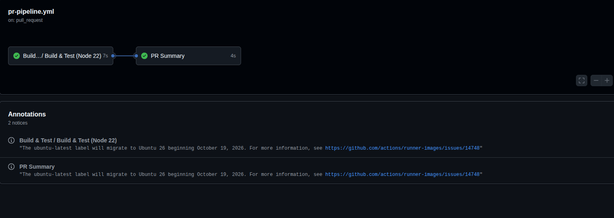
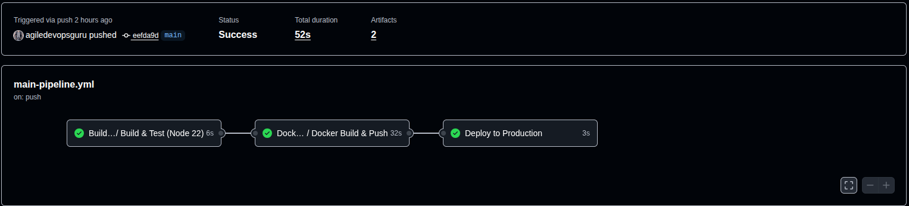
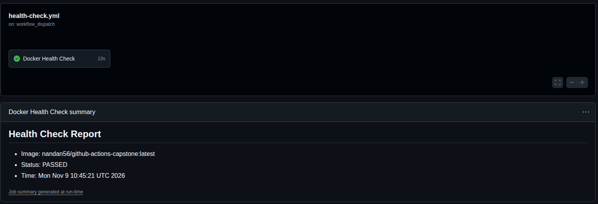
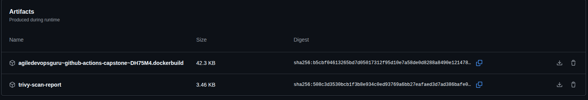

# Day 48 – GitHub Actions Project: End-to-End CI/CD Pipeline

<p align="center">
  <a href="https://github.com/YOUR_GITHUB_USERNAME/github-actions-capstone/actions/workflows/main-pipeline.yml">
    
  </a>
  <a href="https://github.com/YOUR_GITHUB_USERNAME/github-actions-capstone/actions/workflows/pr-pipeline.yml">
    
  </a>
  <a href="https://github.com/YOUR_GITHUB_USERNAME/github-actions-capstone/actions/workflows/health-check.yml">
    
  </a>
  <a href="https://hub.docker.com/r/YOUR_DOCKERHUB_USERNAME/YOUR_IMAGE_NAME">
    
  </a>
</p>

## Project Overview

This project brings together the GitHub Actions concepts covered from Day 40 to Day 47 into one end-to-end CI/CD pipeline.

The pipeline uses reusable workflows to build and test a Node.js application, build and publish a Docker image, deploy the image through a protected GitHub Environment, and periodically check the application's health.

## Challenge Tasks

### Task 1: Set Up the Project Repo

1. Create a repository named `github-actions-capstone` (or use your existing `github-actions-practice` repository).
2. Add a simple application. This example uses a Node.js Express app with a health endpoint.
3. Add a `Dockerfile` and a basic test for the application.
4. Add a `README.md` describing the project.

**Project structure:**

```text
github-actions-capstone/
├── .github/
│   └── workflows/
│       ├── reusable-build-test.yml
│       ├── reusable-docker.yml
│       ├── pr-pipeline.yml
│       ├── main-pipeline.yml
│       └── health-check.yml
├── images/
│   ├── task4.png
│   ├── task5.png
│   ├── task6.png
│   ├── badges.png
│   └── trivy-artifact.png
├── app.js
├── package.json
├── Dockerfile
└── README.md
```

### Task 2: Reusable Workflow — Build & Test

Create `.github/workflows/reusable-build-test.yml`.

1. Trigger the workflow using `workflow_call`.
2. Define inputs for `node_version` and `run_tests` (boolean, default: `true`).
3. Check out the repository.
4. Set up the requested Node.js version.
5. Install dependencies.
6. Run tests only when `run_tests` is `true`.
7. Expose a `test_result` output.

This workflow is responsible only for building and testing. It does not deploy or publish Docker images.

### Task 3: Reusable Workflow — Docker Build & Push

Create `.github/workflows/reusable-docker.yml`.

1. Trigger the workflow using `workflow_call`.
2. Accept `image_name` and `tag` as inputs.
3. Accept `docker_username` and `docker_token` as secrets.
4. Check out the repository and log in to Docker Hub.
5. Build the Docker image and push the requested tag or tags.
6. Expose the full image path through the `image_url` output.

The `tag` input in the example workflow accepts comma-separated tags, allowing the caller to publish both `latest` and a commit-specific tag in one build.

### Task 4: PR Pipeline

Create `.github/workflows/pr-pipeline.yml`.

1. Trigger on `pull_request` events targeting `main`, for `opened` and `synchronize`.
2. Call the reusable build-and-test workflow with `run_tests: true`.
3. Run a separate `pr-comment` job after the build-and-test job.
4. Print a summary confirming that PR checks passed for the source branch.
5. Do not build or push Docker images from this PR workflow.

**Verify:** Open a pull request targeting `main` and confirm that the test workflow runs without publishing a Docker image.



### Task 5: Main Branch Pipeline

Create `.github/workflows/main-pipeline.yml`.

1. Trigger on pushes to `main`.
2. Run the reusable build-and-test workflow.
3. After successful tests, call the reusable Docker workflow.
4. Publish both `latest` and `sha-<short-commit-hash>` tags.
5. Run a `deploy` job after the Docker job.
6. Configure the job to use the `production` GitHub Environment.
7. Print the image being deployed. Configure required reviewers in the environment if manual approval is desired.

**Verify:** Merge a pull request into `main` and confirm the sequence: build and test → Docker build and push → deploy.



### Task 6: Scheduled Health Check

Create `.github/workflows/health-check.yml`.

1. Trigger the workflow every 12 hours using the cron schedule `0 */12 * * *`.
2. Also support manual execution through `workflow_dispatch`.
3. Pull the latest Docker image from Docker Hub.
4. Start the container in detached mode.
5. Wait for the application to start and check its health endpoint using `curl`.
6. Print whether the health check passed or failed.
7. Stop and remove the container.
8. Write a health-check report to `$GITHUB_STEP_SUMMARY`.



### Task 7: Add Badges & Documentation

1. Add status badges for the main pipeline, PR pipeline, and health check to the repository `README.md`.
2. Add the pipeline architecture to this document.
3. Document possible improvements to the pipeline.

#### Pipeline Architecture

**1. Pull Request Flow — Continuous Integration**

**Trigger:** A pull request is opened or updated against `main`.

```text
PR opened / updated
        |
        v
Reusable Build & Test
        |
        v
PR Checks Summary
```

**2. Main Branch Flow — Continuous Deployment**

**Trigger:** Code is pushed or merged into `main`.

```text
Push / merge to main
        |
        v
Reusable Build & Test
        |
        v
Docker Build & Push
        |
        v
Deploy to Production
```

**3. Scheduled Monitoring**

**Trigger:** Every 12 hours, or manually through `workflow_dispatch`.

```text
Scheduled / Manual Trigger
        |
        v
Pull Latest Docker Image
        |
        v
Start Container
        |
        v
Check Health Endpoint
        |
        v
Write Job Summary & Clean Up
```


---

## Brownie Points: Add Security to Your Pipeline

Add a DevSecOps security scan to the main pipeline.

1. Scan the Docker image using `aquasecurity/trivy-action`.
2. Configure the scan to fail when a `CRITICAL` severity vulnerability is found.
3. Generate a SARIF report and upload it as a workflow artifact.



---

## Workflow YAML Files

The five workflow files used in this project are:

- `reusable-build-test.yml` — reusable Node.js build and test workflow.
- `reusable-docker.yml` — reusable Docker build and push workflow.
- `pr-pipeline.yml` — pull request validation workflow.
- `main-pipeline.yml` — main branch CI/CD workflow.
- `health-check.yml` — scheduled and manually triggered container health check.

See the workflow files in `.github/workflows/` for the implementation.

---

## Docker Hub Image

Docker Hub repository: `https://hub.docker.com/r/YOUR_DOCKERHUB_USERNAME/YOUR_IMAGE_NAME`

Replace the placeholder with the actual repository URL after publishing the image.

## Future Improvements

- Add Slack notifications for successful and failed workflow runs.
- Introduce separate staging and production environments.
- Add deployment rollback when a health check fails.
- Add dependency and container vulnerability scanning.
- Store deployment configuration and credentials securely.
- Add integration tests before production deployment.
